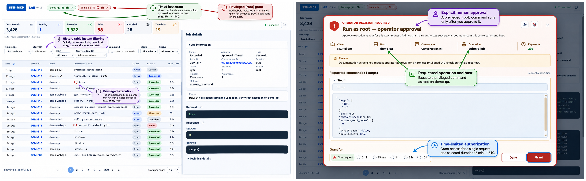

# SSH-MCP

SSH-MCP is a self-hosted [Model Context Protocol](https://modelcontextprotocol.io/)
server for audited SSH commands, bounded file operations and operator-controlled
access. OAuth-protected clients select explicitly allowed SSH hosts; the
service uses pinned host keys and the remote account's existing permissions.

## Operator Console and approvals

[View Operator Console full size](docs/images/operator-console-demo.png) · [View approval dialog full size](docs/images/operator-approval-demo.png)

*Illustrative demo screenshots with synthetic hosts, commands, identifiers, and history counts. No live credentials or infrastructure details are shown.*

This project is licensed under Apache-2.0. To deploy, follow the
[getting started guide](docs/getting-started.md) and configure a trusted HTTPS
reverse proxy, OAuth and a dedicated SSH account. A prebuilt Linux AMD64 image
is available on [Docker Hub](https://hub.docker.com/r/keeperlink/ssh-mcp):
`keeperlink/ssh-mcp:0.1.1` (`latest` also available). Prefer the numbered
tag or an immutable digest for reproducible deployments.

## What it does

- Execute synchronous commands, durable asynchronous jobs and sequential
  batches; inspect bounded results after disconnects.
- Request eligible job/batch cancellation, preserving uncertain-outcome status.
- Read/write text, preview/apply multi-file patches and transfer bounded
  binary files (native upload currently requires a ChatGPT attachment).
- Require operator decisions for restricted hosts or privileged execution,
  with scoped and expiring access grants.
- Display history, approvals and cancellation in the password-protected
  **Operator Console** (`/console`).

SSH-MCP is **not a remote shell sandbox**. Authorize only dedicated
least-privilege accounts on hosts you explicitly trust.

## Choose a Docker Compose example

**SSH-MCP needs a trusted HTTPS reverse proxy**, but it does **not**
require Caddy. First configure the application; then choose an HTTPS
setup appropriate to your infrastructure.

| Example | When to use | Public HTTPS |
| --- | --- | --- |
| [Basic](examples/basic/compose.yaml) | You already have HAProxy, Nginx, Traefik or another HTTPS proxy on the same Linux host | Bring your own proxy |
| [Caddy](examples/standalone/compose.yaml) | You do **not** have a proxy and want automatic HTTPS certificates | Bundled optional Caddy |
| [Hardened](examples/hardened/compose.yaml) | You have an existing HTTPS proxy and want tighter container isolation | Bring your own proxy |

Start with [Getting started](docs/getting-started.md). Basic and
hardened Compose bind application HTTP **only to 127.0.0.1** and
**require Docker Engine 28.0.0 or newer** for safe loopback port
isolation. Older Engine releases can expose localhost-published ports
to the same Layer 2 network; do not use these examples on older
versions without an independently reviewed host firewall policy.
They are **not** public HTTPS endpoints on their own. The optional
Caddy example publishes only ports 80/443 and keeps the app on
its private bridge.

For all three: protect private environment files, supply a dedicated
SSH identity, independently verify pinned host keys, enable OAuth,
restrict the remote SSH account and retain audit history. The hardening
example adds defense in depth; it does not replace authentication.

## Documentation

| Topic | Guide |
| --- | --- |
| Start with one application container | [Getting started](docs/getting-started.md) |
| Existing HTTPS proxy or optional Caddy | [HTTPS and reverse proxies](docs/reverse-proxies.md) |
| Additional container restrictions | [Hardening](docs/hardening.md) |
| Settings and inventory | [Configuration](docs/configuration.md) |
| OAuth client login | [OAuth clients](docs/oauth-clients.md) |
| Trust and security boundaries | [Security](docs/security.md) |
| Commands and jobs | [Commands and jobs](docs/commands-jobs.md) |
| Browser history | [Operator Console](docs/operator-console.md) |
| File operations and edits | [File operations](docs/file-operations.md), [Patch workflows](docs/patch-workflows.md) |
| Backups, monitoring, fixes | [Operations](docs/operations.md), [Troubleshooting](docs/troubleshooting.md) |

## Compatibility and development

For upgrades from earlier installations, preserve the persistent database,
signed policy and SSH host-key trust. Read [Upgrade compatibility](docs/upgrade-compatibility.md)
before changing image or state paths.

Development uses Python 3.12; repository validation checks Ruff, strict
mypy, installed-wheel tests, at least 95% combined coverage and a hardened
OCI image. Offline checks do not substitute for separately authorized
real HTTPS/SSH acceptance.

## Contributing and security

See [Public contributing guide](https://github.com/keeperlink/ssh-mcp/blob/main/CONTRIBUTING.md) for local validation and pull requests,
and [Public security policy](https://github.com/keeperlink/ssh-mcp/blob/main/SECURITY.md) for private vulnerability reporting.

## License

SSH-MCP is licensed under the [Apache License 2.0](LICENSE).
See [third-party notices](THIRD_PARTY_NOTICES.md) for dependency licensing.
For maintainers: [Docker Hub publishing](https://github.com/keeperlink/ssh-mcp/blob/main/docs/container-publishing.md).
